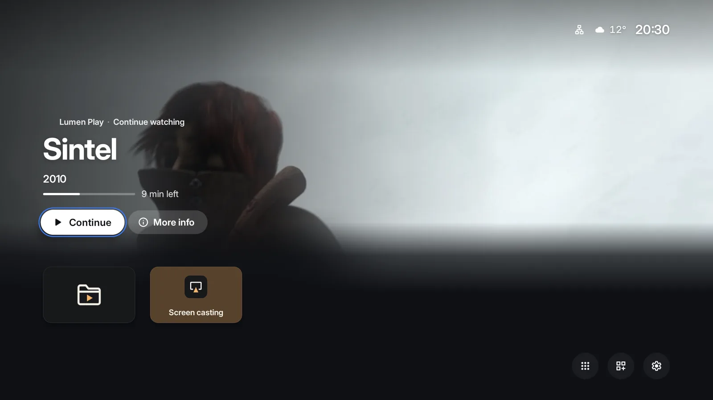
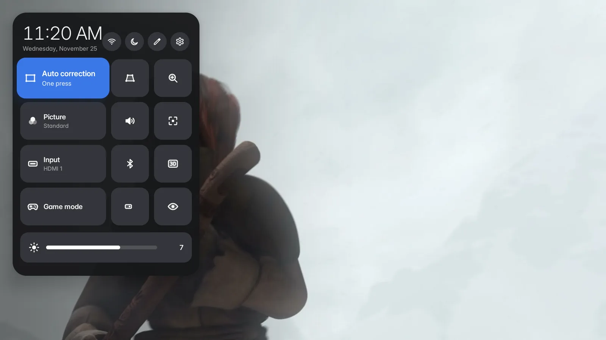
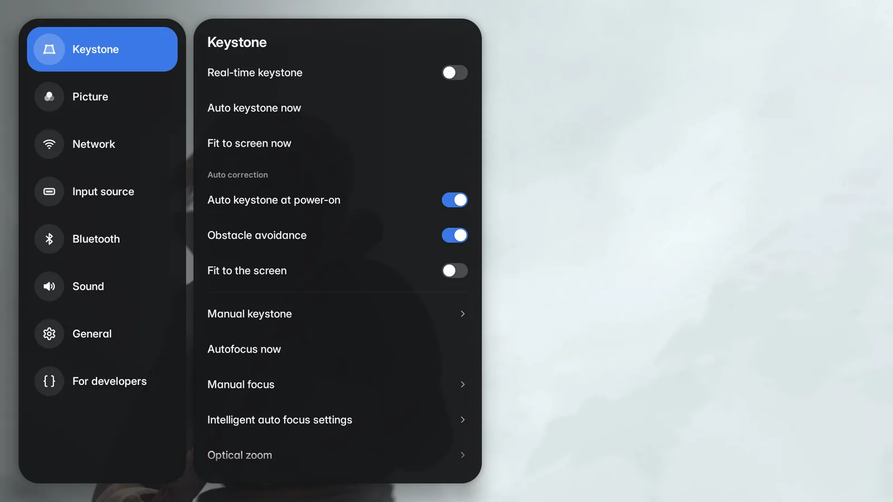
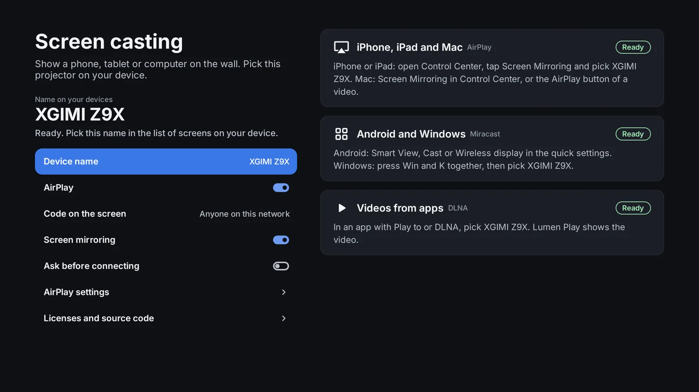

# Lumen OS: custom firmware for XGIMI projectors

English | [Русский](README.ru.md)

Lumen OS is free custom firmware for XGIMI projectors: Android TV 14 built on LineageOS 21, with its own home screen,
quick menu and projector settings. It runs on the XGIMI Z9X, Z9X HB, X50 Ultra, Play 6, RS30, TITAN, MIRA and AURA,
see the list below. Website and install guide: [lumen-os.net](https://lumen-os.net/en/).

## Supported projectors

<!-- models:install:begin -->
| Projector | Model code | What you can do | Guide |
|---|---|---|---|
| XGIMI Z9X | G0082 | Lumen OS Live, Install Lumen OS permanently | [guide](docs/install/z9x/en.md) |
| XGIMI Z9X HB | G0130, G0148 | Lumen OS Live, Install Lumen OS permanently | [guide](docs/install/hb/en.md) |
| XGIMI X50 Ultra | G0111 | Lumen OS Live, Install Lumen OS permanently, beta | [guide](docs/install/x50/en.md) |
| XGIMI X50 Ultra Max | G0100 | Lumen OS Live, Install Lumen OS permanently, beta | [guide](docs/install/x50max/en.md) |
| XGIMI Play 6 | G0058 | Install with a computer | [guide](docs/install/play6/en.md) |
| XGIMI AURA 3 Max | G0104 | Lumen OS Live only, beta | [guide](docs/install/x50/en.md) |
| XGIMI MIRA 4K | G0109 | Lumen OS Live only, beta | [guide](docs/install/x50/en.md) |
| XGIMI MIRA 4K Pro | G0110 | Lumen OS Live only, beta | [guide](docs/install/x50/en.md) |
| XGIMI RS 20 | G0087 | Lumen OS Live only, beta | [guide](docs/install/z9x/en.md) |
| XGIMI RS 20 Plus | G0063 | Lumen OS Live only, beta | [guide](docs/install/z9x/en.md) |
| XGIMI RS 20 Plus Highlight | G0079 | Lumen OS Live only, beta | [guide](docs/install/z9x/en.md) |
| XGIMI RS 20 Plus New | G0086 | Lumen OS Live only, beta | [guide](docs/install/z9x/en.md) |
| XGIMI RS 20 Pro | G0088 | Lumen OS Live only, beta | [guide](docs/install/z9x/en.md) |
| XGIMI RS 20 Pro Master | G0077 | Lumen OS Live only, beta | [guide](docs/install/z9x/en.md) |
| XGIMI RS 20 Pro Max Highlight | G0089 | Lumen OS Live only, beta | [guide](docs/install/z9x/en.md) |
| XGIMI RS 20 Ultra | G0067 | Lumen OS Live only, beta | [guide](docs/install/z9x/en.md) |
| XGIMI RS 20 Ultra Master | G0078 | Lumen OS Live only, beta | [guide](docs/install/z9x/en.md) |
| XGIMI RS30 Pro | G0125 | Lumen OS Live only, beta | [guide](docs/install/x50/en.md) |
| XGIMI RS30 Pro Max | G0124 | Lumen OS Live only, beta | [guide](docs/install/x50/en.md) |
| XGIMI RS30 Ultra | G0114 | Lumen OS Live only, beta | [guide](docs/install/x50/en.md) |
| XGIMI RS30 Ultra Highlight | G0170 | Lumen OS Live only, beta | [guide](docs/install/x50/en.md) |
| XGIMI RS30 Ultra Max | G0115 | Lumen OS Live only, beta | [guide](docs/install/x50/en.md) |
| XGIMI RS30 Ultra Max Flagship | G0155 | Lumen OS Live only, beta | [guide](docs/install/x50/en.md) |
| XGIMI TITAN Noir | H0061 | Lumen OS Live only, beta | [guide](docs/install/x50/en.md) |
| XGIMI TITAN Noir Max | H0063 | Lumen OS Live only, beta | [guide](docs/install/x50/en.md) |
| XGIMI TITAN Noir Pro | H0062 | Lumen OS Live only, beta | [guide](docs/install/x50/en.md) |
<!-- models:end -->

Lumen OS Live starts Lumen OS from the projector and leaves the XGIMI system as it is. Install Lumen OS permanently
replaces the XGIMI system and erases the data on the projector once.

## How to install

Everything happens on the projector over its own internet connection, no computer needed. Step by step:
[install guide on lumen-os.net](https://lumen-os.net/en/install/).

1. Download the Lumen Installer file that ends in `.apk1` from the
   [latest release](https://github.com/Project-Lumen-OS/lumen-installer/releases/latest) and copy it to a USB stick.
2. Plug the stick into the projector and open the file in the XGIMI file manager.
3. Connect the projector to the internet, open Lumen Installer and start Lumen OS Live.
4. If you like it, open Install Lumen OS permanently inside Lumen OS Live.

The Play 6 installs with a computer, see the [Play 6 guide](docs/install/play6/en.md).

## Updates and going back

Lumen OS updates itself. Its updater shows the newest version and installs it when you agree.
In Lumen OS Live a restart brings the XGIMI system back.
After a permanent install, Settings > Device Preferences > About > Back to the XGIMI system names the file you need,
and the page [Restore the XGIMI system](https://lumen-os.net/en/restore/) has the steps for each model.

## Links

- Website: [lumen-os.net](https://lumen-os.net/en/)
- News and questions: [Telegram channel](https://t.me/projector_lumenos) and the
  [XGIMI Z9X thread on 4PDA](https://4pda.to/forum/index.php?showtopic=1121837) (in Russian)
- [Lumen Installer](https://github.com/Project-Lumen-OS/lumen-installer)
- [Report a problem](https://github.com/Project-Lumen-OS/lumen-os/issues)
- [What changed in each version](CHANGELOG.md)
- [Build Lumen OS yourself](docs/selfbuild/en.md)

## Support the project

Lumen OS is free and never sold. If it gave your projector a second life, you can
[support it by card or crypto](https://lumen-os.net/en/#donate).

## License

Apache License 2.0, except `apps/LumenAirPlay` (GPL 3.0 only) and the third party submodules under `apps/third_party`,
which keep their own licenses. See [LICENSE](LICENSE) and [NOTICE](NOTICE).

Lumen OS is an independent project, not affiliated with XGIMI, Google, MediaTek or LineageOS. Their names are
trademarks of their owners. The screenshots show the film Sintel by Blender Foundation, CC BY 3.0.
