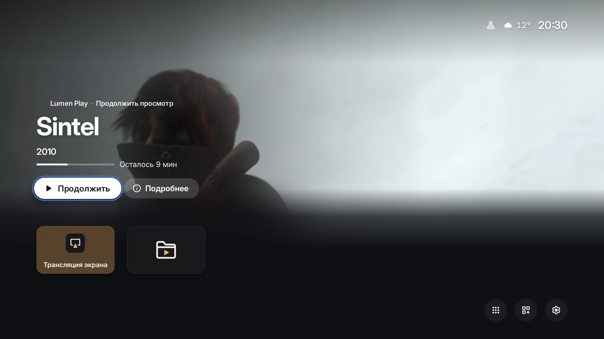
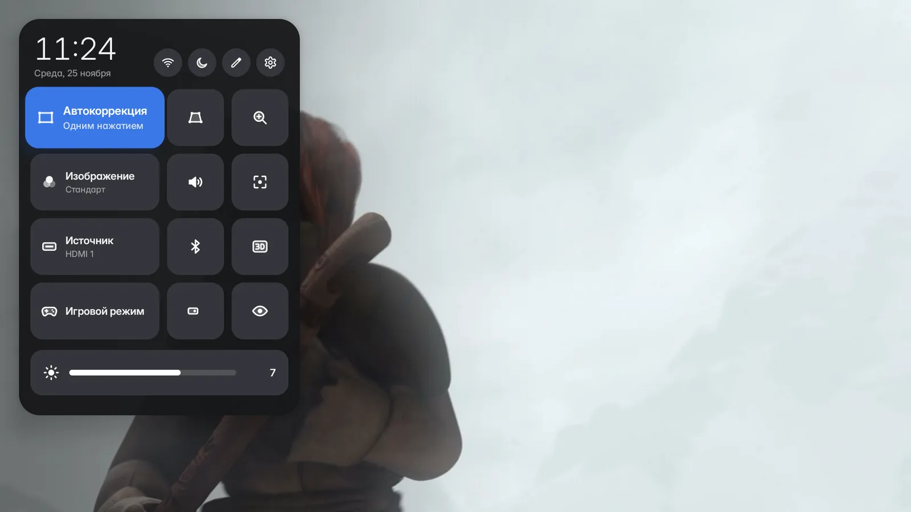
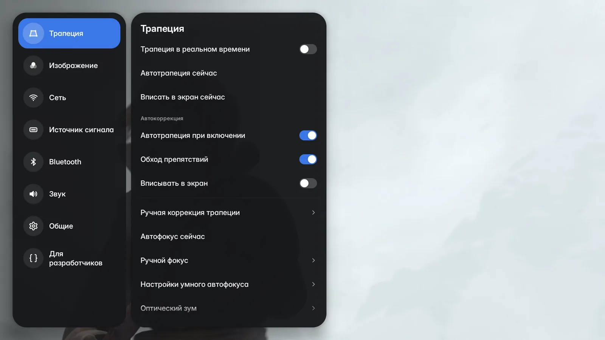
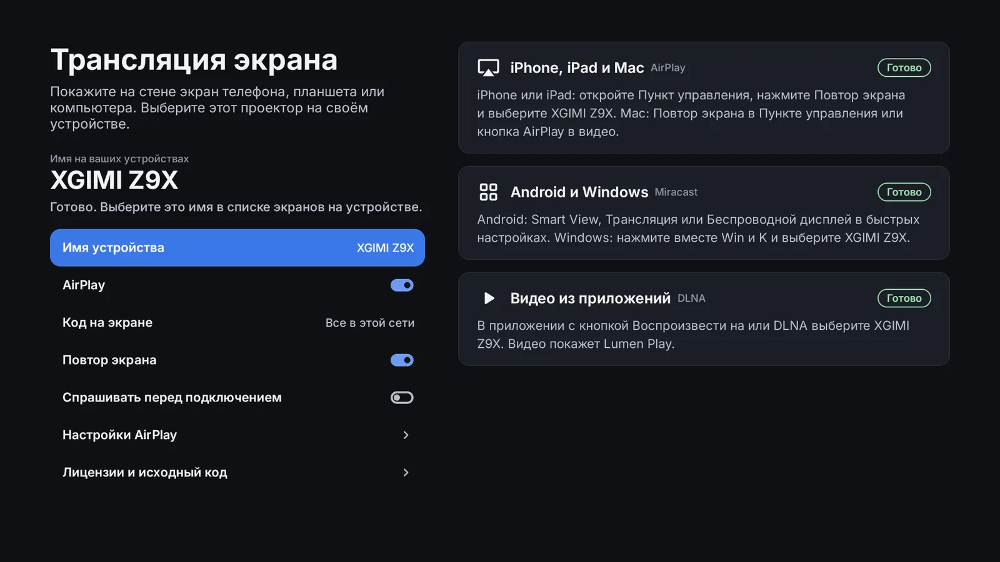

# Lumen OS: кастомная прошивка для проекторов XGIMI

[English](README.md) | Русский

Lumen OS это бесплатная кастомная прошивка для проекторов XGIMI: Android TV 14 на основе LineageOS 21, на русском языке,
со своим главным экраном, быстрым меню и настройками проектора. Работает на XGIMI Z9X, Z9X HB, X50 Ultra, Play 6, RS30,
TITAN, MIRA и AURA, список ниже. Сайт и инструкция по установке: [lumen-os.net](https://lumen-os.net/).

## Поддерживаемые проекторы

<!-- models:install:begin -->
| Проектор | Код модели | Что можно | Инструкция |
|---|---|---|---|
| XGIMI Z9X | G0082 | Lumen OS Live, Установить Lumen OS насовсем | [инструкция](docs/install/z9x/ru.md) |
| XGIMI Z9X HB | G0130, G0148 | Lumen OS Live, Установить Lumen OS насовсем | [инструкция](docs/install/hb/ru.md) |
| XGIMI X50 Ultra | G0111 | Lumen OS Live, Установить Lumen OS насовсем, бета | [инструкция](docs/install/x50/ru.md) |
| XGIMI X50 Ultra Max | G0100 | Lumen OS Live, Установить Lumen OS насовсем, бета | [инструкция](docs/install/x50max/ru.md) |
| XGIMI Play 6 | G0058 | Установка с компьютера | [инструкция](docs/install/play6/ru.md) |
| XGIMI AURA 3 Max | G0104 | только Lumen OS Live, бета | [инструкция](docs/install/x50/ru.md) |
| XGIMI MIRA 4K | G0109 | только Lumen OS Live, бета | [инструкция](docs/install/x50/ru.md) |
| XGIMI MIRA 4K Pro | G0110 | только Lumen OS Live, бета | [инструкция](docs/install/x50/ru.md) |
| XGIMI RS 20 | G0087 | только Lumen OS Live, бета | [инструкция](docs/install/z9x/ru.md) |
| XGIMI RS 20 Plus | G0063 | только Lumen OS Live, бета | [инструкция](docs/install/z9x/ru.md) |
| XGIMI RS 20 Plus Highlight | G0079 | только Lumen OS Live, бета | [инструкция](docs/install/z9x/ru.md) |
| XGIMI RS 20 Plus New | G0086 | только Lumen OS Live, бета | [инструкция](docs/install/z9x/ru.md) |
| XGIMI RS 20 Pro | G0088 | только Lumen OS Live, бета | [инструкция](docs/install/z9x/ru.md) |
| XGIMI RS 20 Pro Master | G0077 | только Lumen OS Live, бета | [инструкция](docs/install/z9x/ru.md) |
| XGIMI RS 20 Pro Max Highlight | G0089 | только Lumen OS Live, бета | [инструкция](docs/install/z9x/ru.md) |
| XGIMI RS 20 Ultra | G0067 | только Lumen OS Live, бета | [инструкция](docs/install/z9x/ru.md) |
| XGIMI RS 20 Ultra Master | G0078 | только Lumen OS Live, бета | [инструкция](docs/install/z9x/ru.md) |
| XGIMI RS30 Pro | G0125 | только Lumen OS Live, бета | [инструкция](docs/install/x50/ru.md) |
| XGIMI RS30 Pro Max | G0124 | только Lumen OS Live, бета | [инструкция](docs/install/x50/ru.md) |
| XGIMI RS30 Ultra | G0114 | только Lumen OS Live, бета | [инструкция](docs/install/x50/ru.md) |
| XGIMI RS30 Ultra Highlight | G0170 | только Lumen OS Live, бета | [инструкция](docs/install/x50/ru.md) |
| XGIMI RS30 Ultra Max | G0115 | только Lumen OS Live, бета | [инструкция](docs/install/x50/ru.md) |
| XGIMI RS30 Ultra Max Flagship | G0155 | только Lumen OS Live, бета | [инструкция](docs/install/x50/ru.md) |
| XGIMI TITAN Noir | H0061 | только Lumen OS Live, бета | [инструкция](docs/install/x50/ru.md) |
| XGIMI TITAN Noir Max | H0063 | только Lumen OS Live, бета | [инструкция](docs/install/x50/ru.md) |
| XGIMI TITAN Noir Pro | H0062 | только Lumen OS Live, бета | [инструкция](docs/install/x50/ru.md) |
<!-- models:end -->

Lumen OS Live запускает Lumen OS с проектора и не трогает систему XGIMI. Установить Lumen OS насовсем значит заменить
систему XGIMI, при этом данные на проекторе один раз стираются.

## Как установить

Всё делается на самом проекторе через его интернет, компьютер не нужен. Подробно по шагам:
[инструкция на lumen-os.net](https://lumen-os.net/install/).

1. Скачайте файл Lumen OS Live с окончанием `.apk1` из
   [последнего выпуска](https://github.com/Project-Lumen-OS/lumen-installer/releases/latest) и скопируйте его на флешку.
2. Вставьте флешку в проектор и откройте файл в файловом менеджере XGIMI.
3. Подключите проектор к интернету, откройте приложение Lumen OS Live и запустите Lumen OS Live.
4. Если понравилось, внутри Lumen OS Live откройте «Установить Lumen OS насовсем».

Play 6 ставится с компьютера, см. [инструкцию для Play 6](docs/install/play6/ru.md).

## Обновления и возврат

Lumen OS обновляется сама. Программа обновления показывает новую версию и ставит её, когда вы согласитесь.
В Lumen OS Live систему XGIMI возвращает обычный перезапуск.
После установки насовсем пункт Настройки > Настройки устройства > Об устройстве > Возврат к системе XGIMI назовёт нужный
файл, а на странице [Вернуть систему XGIMI](https://lumen-os.net/restore/) есть шаги для каждой модели.

## Ссылки

- Сайт: [lumen-os.net](https://lumen-os.net/)
- Новости и вопросы: [канал в Telegram](https://t.me/projector_lumenos) и
  [тема XGIMI Z9X на 4PDA](https://4pda.to/forum/index.php?showtopic=1121837)
- [Lumen OS Live](https://github.com/Project-Lumen-OS/lumen-installer)
- [Сообщить о проблеме](https://github.com/Project-Lumen-OS/lumen-os/issues)
- [Что нового в каждой версии](CHANGELOG.md)
- [Собрать Lumen OS самому](docs/selfbuild/ru.md)

## Поддержать проект

Lumen OS бесплатна и никогда не продаётся. Если она дала проектору вторую жизнь,
[поддержите проект картой или криптой](https://lumen-os.net/#donate).

## Лицензия

<!-- licence:begin -->
Lumen OS создал Kamal Muradov. Собственный код проекта распространяется по лицензии [PolyForm Noncommercial License 1.0.0](LICENSE).
Простыми словами:

- Можно бесплатно пользоваться дома, для учёбы, как хобби и в некоммерческих организациях, например в школах
  и благотворительных фондах.
- Можно менять под себя и изучать, как всё устроено.
- Можно делиться официальными сборками без изменений, вместе с лицензией и файлом [NOTICE](NOTICE).
- Нельзя использовать в коммерческих целях: продавать, брать деньги за установку, использовать в работе
  компании, делать на основе проекта платные дополнения или услуги.

Лицензия действует для всего репозитория, в том числе для прежних версий. Копии, полученные по лицензии
Apache 2.0 до 26 ноября 2026, сохраняют права, которые дала та лицензия.

Части, которые написали другие люди, остаются под своими лицензиями (Apache 2.0, GPL 3.0 у приёмника AirPlay, ISC, OFL, CC BY): [THIRD_PARTY_NOTICES.md](THIRD_PARTY_NOTICES.md). Название и логотип:
[TRADEMARKS.md](TRADEMARKS.md).

Это короткий пересказ. Решает текст лицензии в [LICENSE](LICENSE).
<!-- licence:end -->

Lumen OS это независимый проект, он не связан с XGIMI, Google, MediaTek и LineageOS. Их названия принадлежат их
владельцам. На снимках экрана кадр из фильма Sintel, Blender Foundation, CC BY 3.0.
